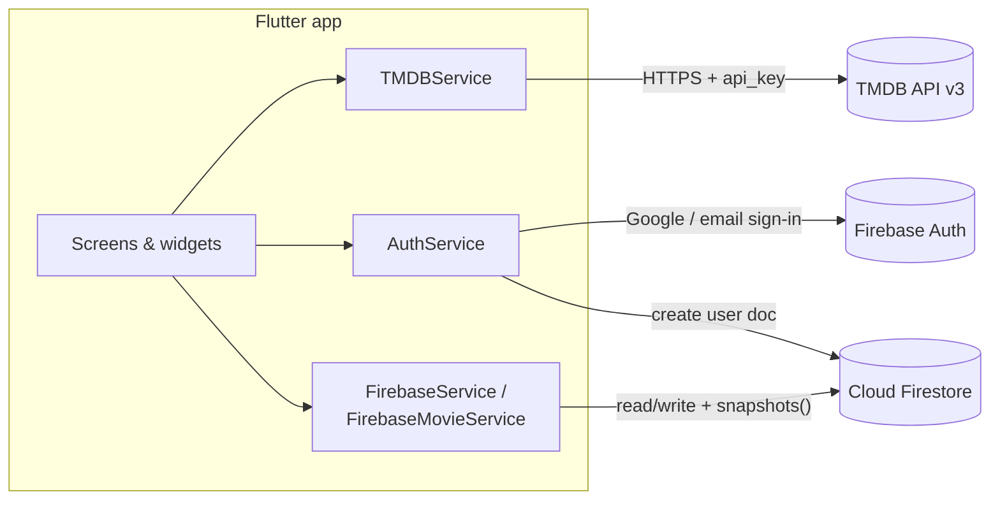

# FilmSphere

**A social movie tracker built with Flutter and Firebase: discover films from TMDB, track them in a personal watchlist, rate and review them, and see what the people you follow are watching.**

Built as a team project for the Honors in Mobile & Software App Development programme at K.J. Somaiya.

---

## Features

**Discovery (TMDB)**
- Home feed with Trending (weekly), Top Rated and Upcoming rows
- Genre chips (Action, Drama, Comedy, Sci-Fi, Horror, Romance) that reload the feed via TMDB `/discover`
- "See all" browse screen per category with infinite-scroll pagination (Trending, Top Rated, Now Playing, Upcoming)
- Movie search from the home screen

**Movie details**
- Overview, runtime, genres, cast and similar movies
- Add to list as Planning / Watching / Completed / Dropped
- Favourite toggle and a 0–10 personal score
- "Friends activity" panel: which people you follow have this movie in their list, and in what status
- Share a movie to the social feed

**Watchlist**
- Real-time list backed by a Firestore stream
- Filter by All / Favourites / Planning / Watching / Completed / Dropped
- Sort by date added, title, TMDB rating, release year or your own score
- Change status, update score or remove an entry

**Reviews**
- Write a review (minimum 50 characters) with a score
- Per-movie review list with like / dislike and threaded comments

**Social**
- "All Posts" and "Following" feeds
- Create posts, like / dislike, comment
- Search users and follow / unfollow

**Auth**
- Google Sign-In (Android + Web) and email/password sign-up / sign-in via Firebase Auth
- A Firestore user profile document is created on first sign-in

> Profile screen: name, email and avatar come from Firebase Auth. The stat tiles and "recent" list are still static placeholders (see [Known limitations](#known-limitations)).

## Screenshots

| Login | Home | Movie detail |
|---|---|---|
|  |  |  |

| Watchlist | Social | Write review |
|---|---|---|
|  |  |  |

## Tech stack

| Area | Choice |
|---|---|
| Framework | Flutter 3.32 / Dart 3.8 (Android, Web) |
| State | `StatefulWidget` + `setState`, `StreamBuilder` / `FutureBuilder` for Firestore |
| Backend | Firebase Auth, Cloud Firestore |
| Sign-in | `google_sign_in` |
| Movie data | TMDB REST API v3 via `http` |
| Config | `flutter_dotenv` (`.env` holds the TMDB key) |
| UI helpers | `cached_network_image`, `timeago` |

## Architecture

```
lib/
├── main.dart              # App entry, theme, AuthWrapper, bottom-nav shell, routes
├── firebase_options.dart  # Generated by FlutterFire CLI
├── models/                # Movie, UserMovie, User, Activity
├── services/
│   ├── tmdb_service.dart          # TMDB REST client (singleton)
│   ├── api_constants.dart         # TMDB endpoints + image URL helpers
│   ├── auth_service.dart          # Firebase Auth + Google Sign-In + user doc creation
│   ├── firebase_service.dart      # Watchlist, reviews, posts, comments, follows
│   └── firebase_movie_service.dart# Movie-detail list status, favourites, friends activity
├── screens/               # login, home, browse_movies, movie_detail, movie_reviews,
│                          # write_review, watchlist, social, user_search, profile
└── widget/                # movie_card, watchlist_item, review_card, social_post_card,
                           # stat_card, category_chip, activity_card, friend_card
```

Screens talk to services directly; services wrap TMDB (HTTP) and Firebase SDK calls.



## Firestore data model

| Collection | Doc ID | Key fields |
|---|---|---|
| `users` | Auth UID | `username`, `displayName`, `email`, `profileImageUrl`, `bio`, `createdAt`, `stats { totalWatched, totalPlanning, totalDropped, averageRating, totalReviews, followersCount, followingCount }` |
| `user_movies` | `{uid}__{movieId}` | `userId`, `movieId`, `movieTitle`, `moviePosterPath`, `movieBackdropPath`, `movieGenre`, `movieYear`, `movieRating`, `status` (planning / watching / completed / dropped), `isFavourite`, `userScore`, `notes`, `addedAt`, `updatedAt`, `completedAt` |
| `reviews` | auto | `userId`, `movieId`, `movieTitle`, `moviePosterPath`, `reviewText`, `reviewScore`, `likesCount`, `dislikesCount`, `commentsCount`, `createdAt`, `updatedAt` |
| `review_interactions` | `{reviewId}__{uid}` | `reviewId`, `userId`, `interactionType` (like / dislike), `createdAt` |
| `review_comments` | auto | `reviewId`, `userId`, `username`, `commentText`, `createdAt` |
| `social_posts` | auto | `userId`, `username`, `userProfileImage`, `postText`, `postType`, `movieId?`, `reviewId?`, counters, `createdAt` |
| `post_interactions` | `{postId}__{uid}` | `postId`, `userId`, `interactionType`, `createdAt` |
| `post_comments` | auto | `postId`, `userId`, `username`, `commentText`, `createdAt` |
| `followers` | `{followerId}__{followingId}` | `followerId`, `followingId`, `createdAt` |
| `user_feed_cache` | `{followerId}__{postId}` | fan-out written on post creation (not yet read by the app) |

Composite indexes for `user_movies` are in [`firestore.indexes.json`](firestore.indexes.json).

## Setup

**Prerequisites:** Flutter 3.32+ (Dart 3.8+), a Firebase project, a free [TMDB API key](https://www.themoviedb.org/settings/api).

1. **Clone and install**
   ```bash
   git clone https://github.com/shail-712/film_sphere.git
   cd film_sphere
   flutter pub get
   ```
2. **TMDB key.** Copy the example env file and add your key (the app will not build without a `.env` file, because it is bundled as an asset):
   ```bash
   cp .env.example .env
   ```
   ```dotenv
   # .env.example
   TMDB_API_KEY=your_tmdb_v3_api_key_here
   ```
3. **Firebase**
   - Create a Firebase project and enable **Authentication** (Google + Email/Password) and **Cloud Firestore**.
   - Run `flutterfire configure` to regenerate `lib/firebase_options.dart` and `android/app/google-services.json` for your project.
   - For Google Sign-In on Web, set your OAuth Web Client ID in `web/index.html` (`google-signin-client_id`) and in `lib/services/auth_service.dart`.
   - For Android Google Sign-In, add your debug SHA-1 to the Firebase Android app.
   - Deploy indexes: `firebase deploy --only firestore:indexes`. Firestore will also print links to create any missing composite indexes the first time a query runs.

## Run and test

```bash
flutter run -d chrome          # Web
flutter run                    # Connected Android device / emulator
flutter analyze
flutter test
```

## Known limitations

- Profile stat tiles and "recent" list are static placeholders and don't yet read the `users.stats` field.
- `test/` only contains the default Flutter template test; there is no real test suite yet.
- No Firestore security rules are versioned in this repo.
- TMDB failures fall back to bundled sample movies instead of showing an error state.

## Team & credits

FilmSphere was built by a team at K.J. Somaiya:

- **Shayaan Amir** ([@PlatinumBeing](https://github.com/PlatinumBeing)): TMDB integration, Firebase/Google Sign-In, auth, watchlist DB integration, reviews, social feed, user search
- **Shail** ([@shail-712](https://github.com/shail-712)): see below
- _Other team members: add names here_

Movie data and images are provided by [TMDB](https://www.themoviedb.org/). This product uses the TMDB API but is not endorsed or certified by TMDB.

### My contributions (Shail)

Based on commit history and `git blame` (about 3,200 of roughly 10,400 lines in `lib/`):

- **Initial app scaffold and UI prototype:** project setup, app shell with theme and bottom navigation (`main.dart`), `Movie` / `User` / `Activity` models, and first versions of the Home, Watchlist, Social and Profile screens, plus the `MovieCard`, `StatCard`, `CategoryChip`, `ActivityCard`, `FriendCard` and `WatchlistItem` widgets.
- **Browse screen:** `browse_movies_screen.dart`, a category / genre browse view with infinite-scroll pagination over TMDB, wired from the home screen's "See all".
- **Movie detail + Firestore integration:** rewrote `movie_detail_screen.dart` and wrote `firebase_movie_service.dart`. This added list status (planning / watching / completed / dropped), favourites, a personal score dialog, user-stat recomputation, and a "friends activity" panel that batches `whereIn` queries over followed users.
